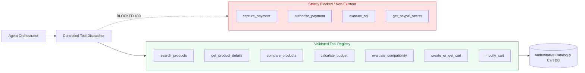

# Controlled Agent Tool Specifications & Orchestration Registry

This document details the 7 controlled tools available to the **PayPal Intent Agent**. All tools feature strict Zod input validation, deterministic database access, and architectural isolation from payment authorization and credentials.

---

## 1. Tool Orchestration Overview



### Security Invariants:
1. **Zero Raw SQL Execution:** The agent cannot execute arbitrary SQL queries or string concatenations. All queries execute through compiled, parameterized SQLite statements.
2. **Zero Access to Secrets:** No tool can access `PAYPAL_CLIENT_SECRET` or internal authentication tokens.
3. **Zero Payment Authorization:** The tool registry contains no endpoints to authorize or capture payments. Payment capture requires explicit user consent in the PayPal popup.

---

## 2. Tool Reference & Schemas

### Tool 1: `search_products`
Discovers in-stock catalog products matching search keywords, category filters, and price ranges.

**Zod Schema:**
```typescript
z.object({
  query: z.string().optional(),
  categoryId: z.string().optional(),
  minPrice: z.number().min(0).optional(),
  maxPrice: z.number().min(0).optional(),
  inStockOnly: z.boolean().optional().default(true),
  limit: z.number().min(1).max(50).optional().default(10),
});
```

**Example Invocation:**
```json
{
  "tool": "search_products",
  "parameters": {
    "categoryId": "keyboards",
    "maxPrice": 150
  }
}
```

**Output Envelope:**
```json
{
  "count": 2,
  "products": [
    {
      "id": "prod_kb_01",
      "sku": "KB-KEYCRAFT-PRO",
      "title": "KeyCraft Pro Wireless Mechanical Keyboard",
      "categoryId": "keyboards",
      "brand": "KeyCraft",
      "basePrice": 139.99,
      "currency": "USD",
      "rating": 4.8,
      "reviewCount": 412,
      "inStock": true,
      "attributes": [
        { "key": "switch_type", "value": "Gateron Brown Tactile" },
        { "key": "connectivity", "value": "Bluetooth 5.1, 2.4GHz Wireless, USB-C" }
      ]
    }
  ]
}
```

---

### Tool 2: `get_product_details`
Retrieves comprehensive specifications, attributes, ratings, and descriptions for a specific product ID.

**Zod Schema:**
```typescript
z.object({
  productId: z.string().min(1, 'productId is required'),
});
```

**Example Invocation:**
```json
{
  "tool": "get_product_details",
  "parameters": {
    "productId": "prod_mon_01"
  }
}
```

---

### Tool 3: `compare_products`
Generates a side-by-side comparison matrix of 2 to 4 products, identifying common features, differing attributes, and value metrics.

**Zod Schema:**
```typescript
z.object({
  productIds: z
    .array(z.string().min(1))
    .min(2, 'Must provide at least 2 product IDs to compare')
    .max(4, 'Can compare at most 4 products simultaneously'),
});
```

**Example Invocation:**
```json
{
  "tool": "compare_products",
  "parameters": {
    "productIds": ["prod_mon_01", "prod_mon_02"]
  }
}
```

---

### Tool 4: `calculate_budget`
Computes authoritative order subtotals, tax (8%), shipping, and total amounts using safe integer minor units (`Money` utility), preventing floating-point precision errors.

**Zod Schema:**
```typescript
z.object({
  items: z
    .array(
      z.object({
        productId: z.string().min(1),
        quantity: z.number().int().min(1).default(1),
      })
    )
    .min(1, 'At least one item is required to calculate budget'),
  taxRate: z.number().min(0).max(0.5).optional().default(0.08),
  shippingFee: z.number().min(0).optional().default(0.0),
});
```

**Example Output:**
```json
{
  "subtotal": 519.98,
  "taxAmount": 41.60,
  "shippingFee": 0.00,
  "totalAmount": 561.58,
  "currency": "USD",
  "itemCount": 2
}
```

---

### Tool 5: `evaluate_compatibility`
Verifies hardware synergy and cross-device compatibility across candidate combinations.

**Checked Synergies:**
- **USB-C Power Delivery:** Confirms monitor supplies 90W PD to power the connected laptop.
- **VESA 100 Mounting:** Confirms monitor arm matches monitor mounting holes.
- **Bluetooth Ecosystem:** Confirms keyboard and mouse support multi-device Bluetooth.

**Zod Schema:**
```typescript
z.object({
  productIds: z.array(z.string().min(1)).min(1),
  intentRequirements: z.array(z.string()).optional(),
});
```

**Example Output:**
```json
{
  "isCompatible": true,
  "compatibilityScore": 1.0,
  "evaluatedProductCount": 3,
  "verifiedMatches": [
    "Single-cable USB-C connectivity: ViewCraft 27-inch delivers power directly to NovaBook 14.",
    "VESA 100x100 alignment: ErgoLift Arm mounts seamlessly to ViewCraft Display.",
    "Unified Bluetooth workspace: Both KeyCraft Pro and PrecisionGlide Mouse support Bluetooth."
  ],
  "warnings": []
}
```

---

### Tool 6: `create_or_get_cart`
Creates or retrieves the active shopping cart bound to the current session and intent.

**Zod Schema:**
```typescript
z.object({
  sessionId: z.string().min(1),
  intentSessionId: z.string().min(1),
});
```

---

### Tool 7: `modify_cart`
Stages, modifies, or clears cart items deterministically.

**Zod Schema:**
```typescript
z.object({
  cartId: z.string().min(1),
  action: z.enum(['add', 'remove', 'update_quantity', 'clear']),
  productId: z.string().optional(),
  itemId: z.string().optional(),
  quantity: z.number().int().min(1).optional(),
});
```

---

## 3. Tool Dispatcher & Security Enforcement

All tool calls pass through `agentToolsService.executeTool(toolName, parameters)`.
- If an unauthorized tool name is requested (e.g. `capture_payment`, `authorize_payment`, `execute_sql`):
  ```json
  {
    "toolCallId": "tc_...",
    "tool": "capture_payment",
    "success": false,
    "error": "Tool \"capture_payment\" is not recognized or not authorized."
  }
  ```
- If invalid parameters are passed: Zod rejects the execution with clean validation messages.
