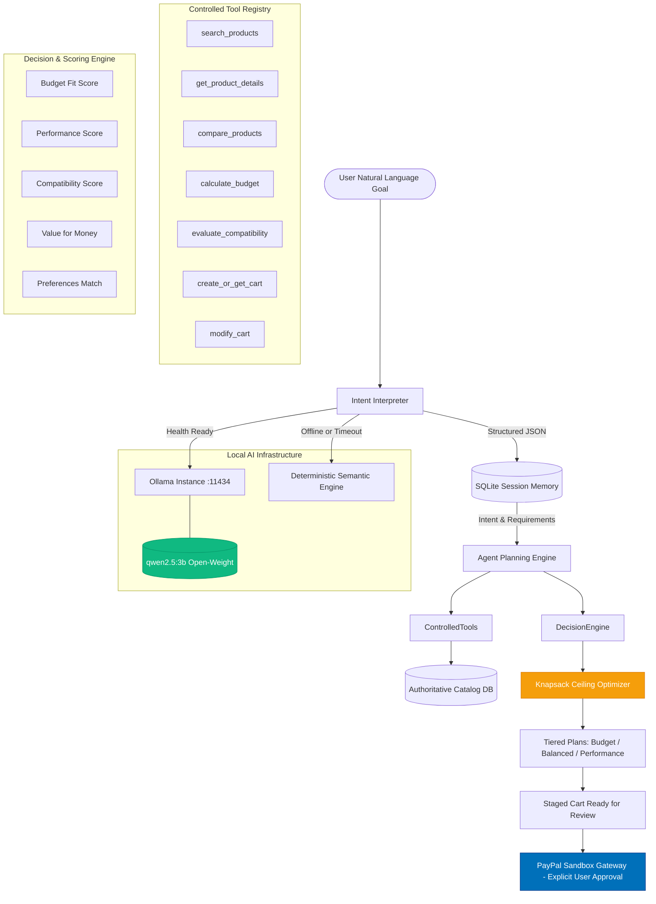

# AI Agent & Intelligence Engine Architecture

This document provides a comprehensive technical overview of the **AI Agent & Intelligence Layer** of **PayPal Intent**, detailing local open-weight model integration, dual-engine reasoning, session memory persistence, and strict security boundaries.

---

## 1. System Topology & Agent Architecture

The PayPal Intent intelligence layer is designed as an agentic decision system rather than a conversational chatbot. It couples neural intent parsing with deterministic mathematical optimization and controlled tool orchestration:



---

## 2. Local AI Infrastructure (Ollama)

PayPal Intent achieves **zero-cost, private execution** without reliance on paid cloud LLMs or recurring API fees.

### Configuration
Configured in `server/.env`:
```bash
# Local AI Infrastructure
OLLAMA_BASE_URL=http://127.0.0.1:11434
OLLAMA_MODEL=qwen2.5:3b
```

### Installation & Setup Guide
1. **Install Ollama:**
   - **Windows / macOS / Linux:** Download the official binary from [ollama.com/download](https://ollama.com/download).
2. **Download Model:**
   ```bash
   ollama pull qwen2.5:3b
   ```
3. **Verify Local Daemon:**
   ```bash
   curl http://127.0.0.1:11434/api/tags
   ```

### Health Monitoring & Graceful Fallback
The `aiService.checkHealth()` utility monitors model availability on startup and runtime:
- `ready`: Ollama daemon is reachable and the target model (`qwen2.5:3b`) is resident.
- `degraded`: Ollama is reachable but target model is missing (falls back gracefully).
- `offline`: Ollama service is not running or unreachable.

---

## 3. Truth in Labeling & Dual-Engine Reasoning

To maintain absolute transparency with evaluators and users, the intelligence engine implements a strict **Truth in Labeling** guarantee:

> [!IMPORTANT]
> **Deterministic fallback outputs are NEVER falsely labeled as AI-generated.**

Every response returned by `POST /api/intents` and `POST /api/plans` includes auditable metadata:
```json
{
  "meta": {
    "isAiGenerated": true,
    "engine": "ollama",
    "model": "qwen2.5:3b"
  }
}
```
If Ollama times out or is offline, the metadata explicitly states:
```json
{
  "meta": {
    "isAiGenerated": false,
    "engine": "deterministic-fallback",
    "model": "deterministic-semantic-engine"
  }
}
```

---

## 4. Intent Understanding & Multi-Currency Processing

The Intent Interpreter extracts 9 dimensions of structured meaning from raw natural language:

| Dimension | Description | Extraction Example |
| :--- | :--- | :--- |
| **Primary Objective** | Clean noun phrase summarizing user's goal | *"Complete home workstation"* |
| **Budget Ceiling** | Authoritative ceiling number and boolean flag | `50000`, `isHardCeiling: true` |
| **Currency** | Multi-currency detection (`$`, `₹`, `€`, `£`, `USD`, `INR`, `EUR`, `GBP`) | `INR` |
| **Product Requirements** | Decomposed categories mapped to catalog | `monitors` (0.45), `keyboards` (0.25), `mice` (0.15) |
| **Primary & Secondary Uses** | Specific domain workflows | Primary: *"Programming"*, Secondary: *"Graphic design"* |
| **User Preferences** | Ergonomics, aesthetic, connectivity | `ergonomics: true`, `connectivity: 'wireless'` |
| **Restrictions** | Negative constraints or mandatory specifications | `["Do not exceed budget ceiling of INR 50000"]` |
| **Quality Tier** | Inferred budget vs specification expectation | `'budget'`, `'balanced'`, or `'performance'` |
| **Missing Information** | Gaps in requirements triggering clarifying questions | *"What OS will this setup connect to?"* |

---

## 5. Decision Engine & Multi-Tier Optimization

The decision engine transparently evaluates candidate products using a weighted composite formula:

$$\text{Composite Score} = w_b \cdot S_{\text{budget}} + w_p \cdot S_{\text{perf}} + w_c \cdot S_{\text{compat}} + w_v \cdot S_{\text{value}} + w_u \cdot S_{\text{pref}}$$

- **Budget Fit ($S_{\text{budget}}$):** Proximity to the category's allocated budget ceiling ($C \times \text{share}$). Overruns are heavily penalized.
- **Performance Suitability ($S_{\text{perf}}$):** Evaluation of product specs against primary/secondary use (e.g. 4K IPS panel and tactile switches for software development).
- **Feature Compatibility ($S_{\text{compat}}$):** Synergies such as USB-C 90W Power Delivery, VESA 100 mounting, and multi-device Bluetooth.
- **Value for Money ($S_{\text{value}}$):** Rating ratio weighted by logarithmic review volume.
- **User Preferences ($S_{\text{pref}}$):** Adherence to requested constraints (e.g. wireless, ergonomic, brand preference).

### Tiered Bundle Strategy
The engine generates 3 distinct candidate bundles:
1. **Budget Tier:** Lowest total cost meeting essential requirements.
2. **Balanced Tier:** Sweet spot maximizing the composite score.
3. **Performance Tier:** Top specifications within the global budget ceiling.

---

## 6. Agent Session Memory & Incremental Refinement

Agent state is persisted in SQLite across 5 relational entities:
- `intent_sessions`: Original goal, parsed objective, budget ceiling, currency.
- `intent_requirements`: Decomposed categories, priorities, estimated budget shares, spec constraints.
- `execution_plans`: Plan version, active tier, total cost, summary.
- `recommendations`: Product linkages, compatibility scores, auditable rationales, locked status.
- `shopping_carts`: Active cart items, quantities, and totals.

### Non-Destructive Goal Refinement
Users can refine their goal (e.g. *"Actually make the keyboard wireless and keep budget under $420"*). The agent merges new constraints into the existing session record:
1. Updates budget ceiling in `intent_sessions`.
2. Updates category constraints in `intent_requirements` (e.g. setting `connectivity: wireless`).
3. Rebalances the execution plan to Version 2 while preserving locked items.

---

## 7. Safety Boundaries & Governance Invariants

The AI agent is subject to strict deterministic safeguards:

| Invariant | Enforcement Mechanism |
| :--- | :--- |
| **No Autonomous Payments** | AI layer has zero imports or access to PayPal capture endpoints. |
| **No Arbitrary SQL Queries** | AI cannot generate raw SQL queries; all data access runs through typed repositories. |
| **No Price Invention** | AI cannot alter prices; line item calculations call `Money.calculateTotals` using authoritative DB rows. |
| **No Inventory Hallucination** | All recommended items must exist in `products` with `in_stock = 1`. |
| **Mandatory User Approval** | Transaction execution strictly requires explicit user interaction via the official PayPal SDK. |
