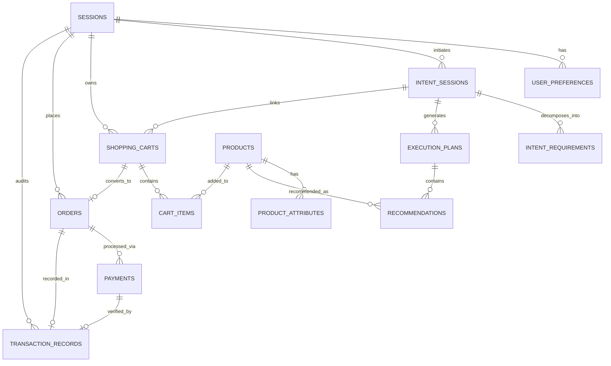

# PayPal Intent — Relational Database Schema Specification
**Document Version:** 1.0.0
**Status:** Approved Technical Architecture
**Deliverable:** Master Prompt 2

---

## 1. Database Architecture & Engine Selection

PayPal Intent utilizes **SQLite 3** running via Node.js 24's native `node:sqlite` module.

### Why SQLite for PayPal Intent:
1. **Zero External Overhead:** Requires no separate database daemon, Docker container, or cloud provisioned instance. Runs out-of-the-box in zero-cost local environments.
2. **ACID Concurrency via WAL Mode:** Configured with `PRAGMA journal_mode = WAL;`, allowing concurrent readers without locking the database during write transactions.
3. **Data Privacy by Design:** All user sessions, intents, and cart records remain on the local machine. No external database analytics or vendor telemetry.
4. **Relational Integrity:** Enforces `PRAGMA foreign_keys = ON;` with cascade deletions to prevent orphaned records.

---

## 2. Entity-Relationship Diagram (ERD)

---

## 3. Comprehensive Entity Specifications

### 3.1 Entity: `sessions`
Represents an anonymous browser session. Avoids mandatory user accounts while preserving intent history across visits.
- **`id`** (`TEXT PRIMARY KEY`): Unique session identifier (`ses_...`).
- **`session_token`** (`TEXT UNIQUE NOT NULL`): Secret bearer token stored in client storage/headers (`tok_...`).
- **`ip_hash`** (`TEXT`): One-way cryptographic hash of client IP for rate limiting without storing raw IP.
- **`user_agent`** (`TEXT`): Client browser agent string.
- **`created_at`** (`TEXT NOT NULL`): ISO 8601 creation timestamp.
- **`updated_at`** (`TEXT NOT NULL`): ISO 8601 update timestamp.
- **`expires_at`** (`TEXT NOT NULL`): Expiration timestamp (default +30 days).
- **Index:** `idx_sessions_token` on `session_token`.

### 3.2 Entity: `user_preferences`
Optional persistent settings configured by the user during intent planning.
- **`id`** (`TEXT PRIMARY KEY`): Unique ID.
- **`session_id`** (`TEXT NOT NULL, FK -> sessions(id) ON DELETE CASCADE`): Owning session.
- **`preferred_currency`** (`TEXT NOT NULL DEFAULT 'USD'`): 3-letter ISO currency code.
- **`quality_preference`** (`TEXT NOT NULL CHECK(quality_preference IN ('budget', 'balanced', 'premium'))`).
- **`brand_flexibility`** (`TEXT NOT NULL CHECK(brand_flexibility IN ('strict', 'flexible', 'open'))`).
- **`default_constraints`** (`TEXT`): Serialized JSON object of persistent constraints (e.g., preferred materials).
- **Index:** `idx_user_preferences_session` on `session_id`.

### 3.3 Entity: `intent_sessions`
Captures each individual high-level user objective and budget ceiling.
- **`id`** (`TEXT PRIMARY KEY`): Intent identifier (`int_...`).
- **`session_id`** (`TEXT NOT NULL, FK -> sessions(id) ON DELETE CASCADE`): Associating session.
- **`raw_prompt`** (`TEXT NOT NULL`): The verbatim input provided by the user.
- **`parsed_objective`** (`TEXT`): Summarized goal synthesized by AI.
- **`budget_amount`** (`REAL`): Numerical budget limit.
- **`budget_currency`** (`TEXT NOT NULL DEFAULT 'USD'`).
- **`is_hard_ceiling`** (`INTEGER NOT NULL DEFAULT 1`): Boolean (1 = strict ceiling, 0 = soft guide).
- **`urgency`** (`TEXT CHECK(urgency IN ('low', 'standard', 'high'))`).
- **`status`** (`TEXT CHECK(status IN ('pending', 'analyzed', 'planned', 'cart_prepared', 'completed', 'abandoned'))`).
- **Indexes:** `idx_intent_sessions_session` on `session_id`, `idx_intent_sessions_status` on `status`.

### 3.4 Entity: `intent_requirements`
The decomposed functional roles generated by the AI from the intent session.
- **`id`** (`TEXT PRIMARY KEY`): Requirement ID.
- **`intent_session_id`** (`TEXT NOT NULL, FK -> intent_sessions(id) ON DELETE CASCADE`).
- **`category_id`** (`TEXT NOT NULL`): Target catalog category (e.g. `microphone`, `desk`).
- **`category_name`** (`TEXT NOT NULL`): Human-readable name (e.g. "Broadcast Dynamic Microphone").
- **`priority`** (`TEXT NOT NULL CHECK(priority IN ('essential', 'recommended', 'optional'))`).
- **`estimated_budget_share`** (`REAL NOT NULL`): Percentage of budget allocated (0.0 to 1.0).
- **`spec_constraints`** (`TEXT`): JSON string of technical parameters required for this category.
- **Index:** `idx_intent_reqs_intent` on `intent_session_id`.

### 3.5 Entity: `execution_plans`
A cohesive multi-product bundle proposed by the optimization solver.
- **`id`** (`TEXT PRIMARY KEY`): Plan identifier (`pln_...`).
- **`intent_session_id`** (`TEXT NOT NULL, FK -> intent_sessions(id) ON DELETE CASCADE`).
- **`version`** (`INTEGER NOT NULL DEFAULT 1`): Increments upon plan rebalancing.
- **`plan_tier`** (`TEXT NOT NULL CHECK(plan_tier IN ('budget', 'balanced', 'performance'))`).
- **`summary`** (`TEXT NOT NULL`): High-level explanation of this plan's design philosophy.
- **`is_active`** (`INTEGER NOT NULL DEFAULT 1`): Boolean indicating whether this is the currently selected plan.
- **`total_estimated_cost`** (`REAL NOT NULL DEFAULT 0.0`): Pre-tax bundle total.
- **`currency`** (`TEXT NOT NULL DEFAULT 'USD'`).
- **Index:** `idx_execution_plans_intent` on `intent_session_id`.

### 3.6 Entity: `products`
Authoritative catalog of available commerce inventory.
- **`id`** (`TEXT PRIMARY KEY`): Product ID (`prod_...`).
- **`sku`** (`TEXT UNIQUE NOT NULL`): Stock keeping unit.
- **`title`** (`TEXT NOT NULL`): Display name.
- **`category_id`** (`TEXT NOT NULL`): Category identifier.
- **`brand`** (`TEXT NOT NULL`): Manufacturer.
- **`base_price`** (`REAL NOT NULL`): Unit price before tax.
- **`currency`** (`TEXT NOT NULL DEFAULT 'USD'`).
- **`rating`** (`REAL NOT NULL DEFAULT 4.5`): Customer rating (0.0 - 5.0).
- **`review_count`** (`INTEGER NOT NULL DEFAULT 0`).
- **`in_stock`** (`INTEGER NOT NULL DEFAULT 1`): Inventory availability flag.
- **`image_url`** (`TEXT NOT NULL`): Product thumbnail/hero asset.
- **`description`** (`TEXT NOT NULL`): Technical specifications and marketing description.
- **Indexes:** `idx_products_sku` on `sku`, `idx_products_category` on `category_id`, `idx_products_price` on `base_price`.

### 3.7 Entity: `product_attributes`
Granular physical, dimensional, and technical specifications for cross-item compatibility filtering.
- **`id`** (`TEXT PRIMARY KEY`): Attribute ID.
- **`product_id`** (`TEXT NOT NULL, FK -> products(id) ON DELETE CASCADE`).
- **`attribute_key`** (`TEXT NOT NULL`): Parameter name (e.g. `connector_type`, `clamp_max_thickness`).
- **`attribute_value`** (`TEXT NOT NULL`): Parameter value (e.g. `XLR`, `2.5 inches`).
- **`attribute_type`** (`TEXT NOT NULL CHECK(attribute_type IN ('string', 'number', 'boolean'))`).
- **`is_filterable`** (`INTEGER NOT NULL DEFAULT 1`).
- **Indexes:** `idx_product_attrs_prod` on `product_id`, `idx_product_attrs_key` on `attribute_key`.

### 3.8 Entity: `recommendations`
Individual item placements within an execution plan.
- **`id`** (`TEXT PRIMARY KEY`): Recommendation ID (`rec_...`).
- **`execution_plan_id`** (`TEXT NOT NULL, FK -> execution_plans(id) ON DELETE CASCADE`).
- **`product_id`** (`TEXT NOT NULL, FK -> products(id) ON DELETE CASCADE`).
- **`category_id`** (`TEXT NOT NULL`).
- **`quantity`** (`INTEGER NOT NULL DEFAULT 1`).
- **`unit_price`** (`REAL NOT NULL`).
- **`compatibility_score`** (`REAL NOT NULL DEFAULT 1.0`): 0.0 to 1.0 compatibility rating with other plan items.
- **`selection_reason`** (`TEXT NOT NULL`): Transparent AI rationale for choosing this item.
- **`tradeOffNotes`** (`TEXT`): Notes regarding compromises made to preserve budget.
- **`is_locked`** (`INTEGER NOT NULL DEFAULT 0`): Boolean locking item against auto-rebalancing.
- **Index:** `idx_recommendations_plan` on `execution_plan_id`.

### 3.9 Entity: `shopping_carts`
Staged order payload ready for PayPal checkout conversion.
- **`id`** (`TEXT PRIMARY KEY`): Cart identifier (`crt_...`).
- **`session_id`** (`TEXT NOT NULL, FK -> sessions(id) ON DELETE CASCADE`).
- **`intent_session_id`** (`TEXT NOT NULL, FK -> intent_sessions(id) ON DELETE CASCADE`).
- **`status`** (`TEXT NOT NULL CHECK(status IN ('active', 'locked', 'converted', 'abandoned'))`).
- **`subtotal`** (`REAL NOT NULL DEFAULT 0.0`).
- **`estimated_tax`** (`REAL NOT NULL DEFAULT 0.0`): Calculated tax (8% baseline).
- **`shipping_fee`** (`REAL NOT NULL DEFAULT 0.0`): Shipping cost.
- **`total_amount`** (`REAL NOT NULL DEFAULT 0.0`): Subtotal + Tax + Shipping.
- **`currency`** (`TEXT NOT NULL DEFAULT 'USD'`).
- **Indexes:** `idx_shopping_carts_session` on `session_id`, `idx_shopping_carts_intent` on `intent_session_id`.

### 3.10 Entity: `cart_items`
Individual line items inside an active shopping cart.
- **`id`** (`TEXT PRIMARY KEY`): Cart item ID.
- **`cart_id`** (`TEXT NOT NULL, FK -> shopping_carts(id) ON DELETE CASCADE`).
- **`product_id`** (`TEXT NOT NULL, FK -> products(id) ON DELETE CASCADE`).
- **`quantity`** (`INTEGER NOT NULL DEFAULT 1`).
- **`unit_price`** (`REAL NOT NULL`).
- **`is_custom_selection`** (`INTEGER NOT NULL DEFAULT 0`): Flag indicating user override.
- **Index:** `idx_cart_items_cart` on `cart_id`.

### 3.11 Entity: `orders`
Server-side order record matching an initialized transaction.
- **`id`** (`TEXT PRIMARY KEY`): Order identifier (`ord_...`).
- **`cart_id`** (`TEXT NOT NULL, FK -> shopping_carts(id) ON DELETE CASCADE`).
- **`session_id`** (`TEXT NOT NULL, FK -> sessions(id) ON DELETE CASCADE`).
- **`intent_session_id`** (`TEXT NOT NULL, FK -> intent_sessions(id) ON DELETE CASCADE`).
- **`order_number`** (`TEXT UNIQUE NOT NULL`): Human-readable tracking string (`PI-XXXXX-XXX`).
- **`status`** (`TEXT NOT NULL CHECK(status IN ('pending', 'approved', 'captured', 'cancelled', 'refunded'))`).
- **`currency`** (`TEXT NOT NULL DEFAULT 'USD'`).
- **`subtotal`**, **`tax_amount`**, **`shipping_amount`**, **`total_amount`** (`REAL NOT NULL`).
- **Indexes:** `idx_orders_number` on `order_number`, `idx_orders_session` on `session_id`.

### 3.12 Entity: `payments`
Direct mapping to official PayPal Sandbox Orders v2 transaction state.
- **`id`** (`TEXT PRIMARY KEY`): Payment ID (`pay_...`).
- **`order_id`** (`TEXT NOT NULL, FK -> orders(id) ON DELETE CASCADE`).
- **`provider`** (`TEXT NOT NULL DEFAULT 'paypal'`).
- **`paypal_order_id`** (`TEXT UNIQUE NOT NULL`): Official PayPal Order ID (e.g. `8RG...`).
- **`paypal_capture_id`** (`TEXT`): Official PayPal Capture ID upon settlement.
- **`status`** (`TEXT NOT NULL CHECK(status IN ('created', 'approved', 'completed', 'failed'))`).
- **`amount`** (`REAL NOT NULL`).
- **`currency`** (`TEXT NOT NULL DEFAULT 'USD'`).
- **`payer_email`** (`TEXT`): PayPal Sandbox buyer email.
- **`payer_id`** (`TEXT`): PayPal Sandbox account ID.
- **`raw_response`** (`TEXT`): Serialized JSON payload returned by PayPal API.
- **Indexes:** `idx_payments_paypal_order` on `paypal_order_id`, `idx_payments_order` on `order_id`.

### 3.13 Entity: `transaction_records`
Permanent, tamper-evident audit record linking intent, plan, and PayPal proof.
- **`id`** (`TEXT PRIMARY KEY`): Transaction record ID (`tx_...`).
- **`payment_id`** (`TEXT NOT NULL, FK -> payments(id) ON DELETE CASCADE`).
- **`order_id`** (`TEXT NOT NULL, FK -> orders(id) ON DELETE CASCADE`).
- **`session_id`** (`TEXT NOT NULL, FK -> sessions(id) ON DELETE CASCADE`).
- **`transaction_hash`** (`TEXT UNIQUE NOT NULL`): Cryptographic SHA-256 hash sealing the record.
- **`status`** (`TEXT NOT NULL CHECK(status IN ('SUCCESS', 'FAILED'))`).
- **`gross_amount`** (`REAL NOT NULL`): Total charged.
- **`fee_amount`** (`REAL NOT NULL DEFAULT 0.0`): PayPal merchant fee.
- **`net_amount`** (`REAL NOT NULL`): Net proceeds.
- **`currency`** (`TEXT NOT NULL DEFAULT 'USD'`).
- **`intent_summary`** (`TEXT NOT NULL`): The original objective fulfilled by this purchase.
- **`audit_snapshot`** (`TEXT NOT NULL`): Full JSON freeze of the purchased items, rationales, and timestamps.
- **Indexes:** `idx_transactions_hash` on `transaction_hash`, `idx_transactions_session` on `session_id`.

---

## 4. Privacy & Anti-PII Design

1. **No User Password Storage:** Operates entirely with cryptographic anonymous session tokens.
2. **No Credit Card Details:** No card numbers, CVVs, or bank credentials ever touch the database; payment authentication is exclusively offloaded to PayPal Sandbox.
3. **Anonymized Telemetry:** IP addresses are hashed using SHA-256 before storage to protect user privacy while enabling rate-limiting safeguards.
