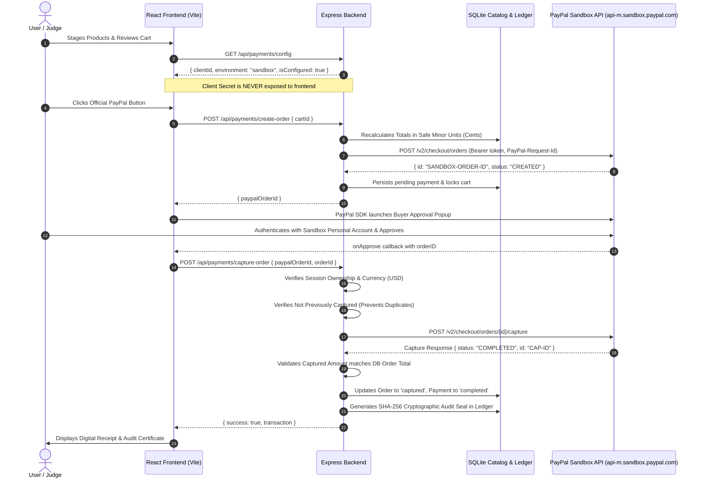

# PayPal Sandbox Setup & Testing Guide

This guide provides complete instructions for judges, evaluators, and developers to test the genuine **PayPal Sandbox** integration in **PayPal Intent**.

---

## 1. Architecture & Security Overview

PayPal Intent implements a production-grade, secure payment architecture adhering strictly to official PayPal developer standards:



### Key Security Commitments
1. **Zero Secret Leakage:** `PAYPAL_CLIENT_SECRET` is never passed to frontend code, build assets, or responses.
2. **Server-Authoritative Pricing:** The frontend never decides product prices or order totals. All calculations are executed server-side in integer minor units directly from the database catalog.
3. **Strict Duplicate Prevention:** Both internal order state and PayPal order IDs enforce idempotency. Double captures return `409 Conflict`.
4. **Human-in-the-Loop Governance:** The AI cannot authorize or capture payments autonomously. Buyer consent inside the official PayPal Sandbox window is mandatory.
5. **No Simulation of Successful Payments:** Real payments strictly invoke the PayPal Sandbox REST API and check for `COMPLETED` capture status.

---

## 2. Obtaining PayPal Sandbox Credentials

To test real sandbox payments with your own PayPal Sandbox account:

1. Log in to the [PayPal Developer Dashboard](https://developer.paypal.com).
2. Under **Apps & Credentials**, select the **Sandbox** tab.
3. Click **Create App** (or select an existing App):
   - **App Name:** `PayPal Intent Demo`
   - **App Type:** `Merchant`
4. Copy your **Client ID** and **Secret**.
5. Navigate to **Testing Tools** > **Sandbox Accounts**:
   - Locate your default **Personal (Buyer)** account (e.g., `sb-buyer@personal.example.com`).
   - Click the three dots `...` > **View/edit account** to view the auto-generated password or set a new one.

---

## 3. Configuring the Environment

Create or edit `server/.env` with your Sandbox credentials:

```bash
# PayPal Sandbox Configuration
PAYPAL_MODE=sandbox
PAYPAL_CLIENT_ID=your_sandbox_client_id_here
PAYPAL_CLIENT_SECRET=your_sandbox_secret_here
PAYPAL_API_BASE=https://api-m.sandbox.paypal.com
```

> **Note:** `.env` is ignored by git (`.gitignore`). Never commit real credentials to version control. The repository includes `.env.example` with sanitized placeholders.

Restart the backend server after editing `.env`:
```powershell
npm run dev
```

---

## 4. Step-by-Step Testing Flow for Evaluators

### Step 1: Stage Products in Cart
1. Launch the application:
   - Frontend: [http://localhost:5173](http://localhost:5173)
   - Backend: [http://localhost:5000](http://localhost:5000)
2. Enter an intent on the home screen (e.g., *"Equip a hybrid desk setup under $600"*).
3. Review the AI-generated plan and add recommended products to the cart.
4. Navigate to **Cart** and click **Proceed to PayPal**.

### Step 2: Review and Authorize
1. On the **Review & Authorize Payment** screen, inspect the line items, authoritative 8% tax calculation, and total due.
2. If credentials are configured in `server/.env`, the official gold **PayPal** button renders automatically.
3. Click the **PayPal** button. An official PayPal Sandbox popup appears.
4. Log in using your PayPal Sandbox **Personal (Buyer)** email and password.
5. Click **Complete Purchase** in the Sandbox window.

### Step 3: Verified Capture & Digital Receipt
1. The frontend invokes `POST /api/payments/capture-order`.
2. The backend connects to PayPal Sandbox, executes the capture, confirms `COMPLETED` status, and generates a SHA-256 transaction hash.
3. The UI automatically transitions to the **Digital Receipt / Audit History** screen (`/history`) displaying:
   - Official PayPal Capture ID
   - SHA-256 Immutable Audit Seal
   - Itemized purchase breakdown with SKU numbers
   - Payer email and transaction status (`SUCCESS`)

---

## 5. Testing Error & Edge-Case Handling

| Test Case | Expected Behavior |
| :--- | :--- |
| **Buyer Cancels in Popup** | Closing the PayPal popup triggers `onCancel`. The cart is preserved; user receives an informative notification. |
| **Duplicate Capture Attempt** | Re-submitting a capture request for a completed order returns `409 Conflict: Order has already been captured`. |
| **Catalog Price Tampering** | Manipulating prices in client network payloads is blocked; server recalculates exact totals from DB before calling PayPal Orders API. |
| **Cross-Session Capture** | Attempting to capture an order created in another session token returns `403 Forbidden: Unauthorized`. |
| **Empty Cart Checkout** | Sending a checkout request with zero items returns `400 Bad Request: Cannot create order for an empty cart`. |

---

## 6. Running the Automated Payment Test Suite

The automated test suite verifies all security invariants, token caching, order creation, and capture error handling:

```powershell
# Run the 10 dedicated PayPal integration tests
npm --workspace=server test -- payment.test.ts

# Run the complete server test suite (44 tests)
npm --workspace=server test
```
