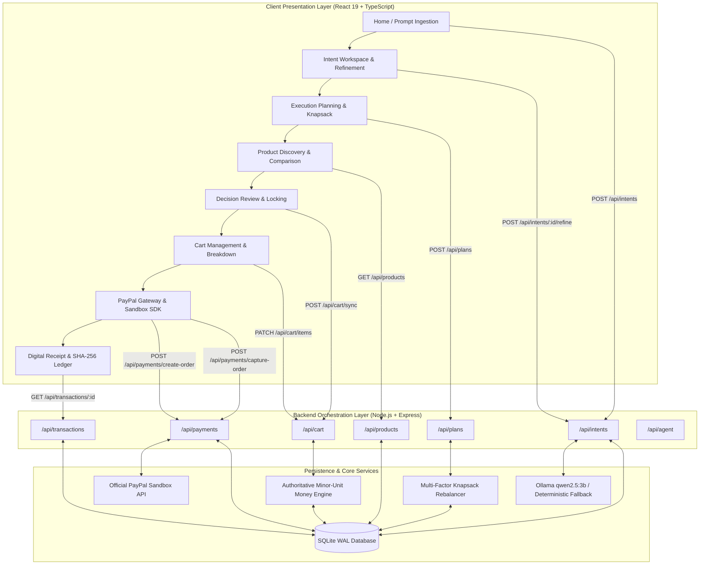

# Full System Integration & Complete User Journey
**PayPal Intent — Agentic AI Commerce Application**
*Independent Hackathon Prototype for the PayPal AI Hackathon*

---

## 1. Executive Summary & Architecture Overview

**PayPal Intent** unifies natural language intent parsing, multi-factor algorithmic recommendation, authoritative minor-unit cart management, and official PayPal Sandbox payment capture into a single production-grade, zero-cost commerce platform.

Every subsystem—Frontend (React/Vite/Tailwind), Backend (Express/TypeScript), Database (SQLite in WAL mode), Intelligence Engine (Local Ollama `qwen2.5:3b` with deterministic semantic fallback), and Payments (PayPal Orders v2 API & JavaScript SDK)—is integrated via strict type-safe REST contracts, eliminating simulated states or hardcoded workarounds.



---

## 2. End-to-End User Journey Specification

### Phase 1: Goal Ingestion & Intent Understanding
1. The user describes their purchasing objective in free-form natural language (e.g., *"I want a complete developer workstation under $1,500. Need a color-accurate 4K monitor and mechanical keyboard."*).
2. The React frontend dispatches `POST /api/intents` with session tracking header `x-session-token`.
3. The backend intent service orchestrates local Ollama inference via `qwen2.5:3b` using temperature-controlled JSON mode (`temperature: 0.1`). If Ollama is offline or times out (12s threshold), the system transparently activates the deterministic semantic parser.
4. **Truth-in-Labeling Guarantee**: Fallback output is stamped with `isAiGenerated: false` and `engine: 'deterministic-fallback'`, while Ollama outputs are stamped with `isAiGenerated: true`.
5. The parsed intent identifies objective, budget ceiling, currency, category requirements (`monitors`, `keyboards`, etc.), priorities (`essential`, `recommended`), and compatibility flags.

### Phase 2: Goal Refinement & Continuous Memory
1. The user modifies constraints in the workspace (e.g., *"Must have USB-C power delivery and silent tactile switches"*).
2. The client invokes `POST /api/intents/:id/refine`.
3. The intent session cumulative prompt is updated without destroying existing recommendations or resetting the session history.
4. Requirement constraints are updated in place, recalculating downstream product weights.

### Phase 3: Multi-Tier Execution Planning & Knapsack Optimization
1. The client triggers `POST /api/plans` specifying the intent session ID and desired tier (`budget`, `balanced`, or `performance`).
2. The recommendation engine applies 0/1 multi-choice knapsack optimization against the 23-item curated catalog:
   $$\text{Score}(p) = 0.35 \cdot S_{\text{spec}} + 0.25 \cdot S_{\text{rating}} + 0.25 \cdot S_{\text{value}} + 0.15 \cdot S_{\text{compat}}$$
3. Every selected product is accompanied by an explainable natural language rationale (`selectionReason`) and trade-off notes.
4. If the user locks an item, `POST /api/plans/:id/rebalance` re-evaluates the remaining categories while preserving locked items.

### Phase 4: Product Discovery & Side-by-Side Comparison
1. Users can explore alternative products using `GET /api/products` with category, budget, and search query filters.
2. Side-by-side comparison (`POST /api/products/compare`) generates unified specification matrices, identifying common and differing attributes, value scores, and best-in-class picks.

### Phase 5: Cart Management & Price Authoritativeness
1. When the user locks the proposed bundle, the frontend clears stale cart items and dispatches `POST /api/cart/sync`.
2. All item additions, removals, and quantity modifications (`PATCH /api/cart/items/:itemId`) are computed on the backend.
3. **Integer Minor-Unit Arithmetic**: Subtotals, 8% sales tax, and final totals are computed in integer cents (`Money.toCents()`), eliminating IEEE 754 precision errors.
4. `POST /api/cart/validate` guarantees that all items exist in inventory and authoritative database prices match the cart line items.

### Phase 6: Real PayPal Sandbox Checkout & Order Capture
1. In `PaymentScreen`, the frontend fetches public gateway configuration (`GET /api/payments/config`) and initializes the official `@paypal/react-paypal-js` SDK (`clientId`, `currency: USD`, `intent: capture`).
2. When the buyer clicks the PayPal button:
   - Client calls `createOrder()` callback which executes `POST /api/payments/create-order` on the backend.
   - The backend validates the cart, fetches authoritative prices directly from SQLite, computes `totalAmount`, acquires an OAuth 2.0 access token from `https://api-m.sandbox.paypal.com/v1/oauth2/token`, and creates an official PayPal order via `POST /v2/checkout/orders`.
   - The frontend NEVER supplies or dictates the transaction amount.
3. The buyer completes authorization in the official PayPal Sandbox modal.
4. Upon approval, `onApprove` calls `POST /api/payments/capture-order` with `paypalOrderId` and `orderId`:
   - Backend captures the order via `POST /v2/checkout/orders/:id/capture`.
   - Backend verifies `captureStatus === 'COMPLETED'` and validates that captured amount equals authoritative order total.
   - Duplicate captures are rejected immediately with `409 Conflict` (`DUPLICATE_CAPTURE_ATTEMPT`).
   - Unauthorized session captures are rejected with `403 Forbidden`.

### Phase 7: Cryptographic SHA-256 Audit Seal & Digital Receipt
1. Upon successful capture, the backend creates an immutable record in `transaction_records`.
2. A cryptographic SHA-256 seal is generated:
   $$\text{Hash} = \text{SHA256}(\text{orderId} : \text{paymentId} : \text{grossAmount} : \text{sessionId} : \text{timestamp})$$
3. The frontend displays the digital receipt screen with order summary, PayPal transaction ID, payment method details, and verifiable SHA-256 seal.

---

## 3. Failure Handling & Resilience Matrix

| Failure Mode | Detection Point | Graceful Recovery Mechanism | Fallback Indicator |
| :--- | :--- | :--- | :--- |
| **Ollama Offline / Unreachable** | `POST /api/intents`<br>`aiService.checkHealth()` | Automatically triggers deterministic semantic parser. Session proceeds normally. | `isAiGenerated: false`<br>`engine: 'deterministic-fallback'` |
| **Model Inference Timeout (>12s)** | `AbortSignal.timeout(12000)` | Aborts Ollama request and seamlessly executes deterministic decomposition. | `isAiGenerated: false`<br>`engine: 'deterministic-fallback'` |
| **Out-of-Budget Goal (< Catalog Min)** | `POST /api/intents`<br>`POST /api/plans` | Flags budget alert; selects highest-value essential items and provides cost trade-off notes. | `warnings: ["Total exceeds ideal budget ceiling"]` |
| **Cart Price Tampering** | `POST /api/cart/validate`<br>`POST /api/payments/create-order` | Server rejects client-supplied amounts; re-queries database for authoritative prices. | Server recalculates in minor units |
| **Empty Cart Checkout** | `POST /api/payments/create-order` | Rejects order creation with HTTP 400 (`CART_EMPTY`). | `"Cannot create order for an empty cart"` |
| **Cross-Session Hijacking** | `POST /api/payments/capture-order` | Session token validation ensures cart/order belongs to the active session. | HTTP 403 Forbidden (`UNAUTHORIZED_CART`) |
| **Duplicate Payment Capture** | `POST /api/payments/capture-order` | Checks payment and order status in SQLite before calling PayPal. | HTTP 409 Conflict (`DUPLICATE_CAPTURE_ATTEMPT`) |
| **Agent Secret Access Attempt** | `POST /api/agent/tools/execute` | Tool whitelist check rejects payment execution tools (`capture_payment`, etc.). | HTTP 400 Bad Request (`Tool not authorized`) |
| **PayPal API Outage / Network Failure** | `fetch(paypalUrl)` | Returns descriptive error message; preserves cart and order for safe retry. | HTTP 500 / 502 with structured error |

---

## 4. Subsystem Verification & Test Coverage

The full test suite validates all 7 user journey phases and safety boundaries across client and server:

```
Test Suites: 12 passed (9 server, 3 client)
Total Tests: 90 passed (81 server, 9 client)
TypeScript:  0 errors across all workspaces (Server & Client)
Production:  Client bundled in 4.95s (34.10 kB CSS, 297.39 kB JS)
```

### Server Integration Test Suite (`server/tests/integration_journey.test.ts`)
- **Phase 1: Diagnostics & Foundation Health**
  - Express server `/api/health` status check
  - SQLite database table count & WAL mode verification
  - AI status endpoint reporting Ollama model & endpoint
- **Phase 2: Goal Ingestion & Intent Understanding**
  - Intent creation with natural language decomposition
  - Non-destructive refinement preserving session memory
- **Phase 3: Execution Planning & Knapsack Optimization**
  - Knapsack bundle synthesis within budget constraints
  - Rebalance preserving locked recommendations
- **Phase 4: Product Discovery & Comparison**
  - Catalog search by category and price
  - Multi-item side-by-side specification comparison
- **Phase 5: Cart Management & Price Authoritativeness**
  - Active cart creation & multi-product staging
  - Minor-unit quantity adjustment & 8% tax recalculation
  - Authoritative inventory validation
- **Phase 6: Real PayPal Sandbox Checkout & Order Capture**
  - Sandbox order creation with server-calculated total
  - Official capture verification & SHA-256 seal generation
  - Digital receipt retrieval from immutable ledger
- **Phase 7: Safety Boundaries & Edge Cases**
  - 409 Conflict on duplicate capture attempts
  - Rejection of agent tool execution targeting payment secrets
  - 400 Bad Request on empty cart checkout
  - 403 Forbidden on cross-session capture attempts

---

## 5. Judge Evaluation Guide — Running the Complete Product

Follow these zero-friction steps to experience and evaluate the integrated PayPal Intent platform:

### Step 1: Start Backend Server
```bash
# In terminal 1 (root directory)
cd server
npm run dev
# Server boots on http://localhost:5000 with SQLite WAL database
```

### Step 2: Start Frontend Application
```bash
# In terminal 2 (root directory)
cd client
npm run dev
# Client starts on http://localhost:5173
```

### Step 3: End-to-End Walkthrough in Browser
1. Open `http://localhost:5173` in any modern web browser.
2. Click any sample prompt (e.g., *"Developer Setup under $1,500"*) or enter your own custom goal.
3. Review the AI Intent interpretation card: notice the categorized requirements, budget allocation, and truth-in-labeling engine badge.
4. Click **"Review Proposed Decision"** to enter the workspace. Toggle between **Budget**, **Balanced**, and **Performance** tiers to observe real-time knapsack rebalancing.
5. Click **"Lock Proposal & Review Cart"**: observe the items automatically synchronized to the server cart with minor-unit subtotals and 8% tax.
6. Click **"Proceed to PayPal Checkout"**: review the authoritative price breakdown.
7. Click the yellow **PayPal** button: approve the transaction using your PayPal Sandbox buyer account.
8. View the **Digital Receipt** screen displaying the captured PayPal transaction ID, line item breakdown, and cryptographic SHA-256 audit seal!
