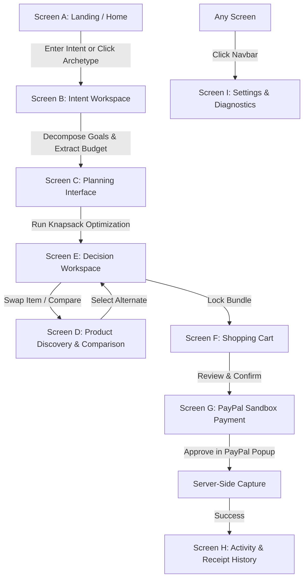

# PayPal Intent — End-to-End UX Flows & State Transitions
**Document Version:** 1.0.0
**Status:** Approved UX Flows
**Deliverable:** Master Prompt 3

---

## 1. Master UX Flow Diagram

---

## 2. Detailed User Experience Flows

### 2.1 Flow 1: Primary Golden Path (Goal-to-Payment)
1. **User lands on Screen A (Home):**
   - User types: *"Equip a 2-person podcast recording studio under $400"*.
   - Clicks **"Analyze & Plan Goal"**.
2. **Transition to Screen B (Intent Workspace):**
   - System displays extraction animation (0.8s).
   - Extracted: Objective = "2-Person Podcast Recording Studio", Budget = $400.00, Hard Ceiling = True.
   - Shows progress steps automatically advancing to Plan Generation.
3. **Transition to Screen E (Decision Workspace):**
   - System presents the **Balanced Optimal Bundle**:
     - 2x AuraVoice USB Broadcast Mics ($129.99 ea).
     - 2x FlexMount Low-Profile Boom Arms ($69.99 ea).
   - Budget Gauge shows: `$399.96 / $400.00 (99.9% utilized, $0.04 remaining)`.
   - Explainer explains: *"Selected USB dynamic mics to avoid requiring external multichannel audio interface, staying within $400 limit."*
4. **Transition to Screen F (Shopping Cart):**
   - User clicks **"Review Cart & Checkout"**.
   - Reviewing itemized list, subtotal ($399.96), tax ($32.00), total ($431.96).
5. **Transition to Screen G (PayPal Sandbox Payment):**
   - User clicks **"Proceed to PayPal Checkout"**.
   - Server creates PayPal Sandbox Order v2.
   - User clicks official PayPal Sandbox authorization button.
   - Interactive modal opens. User approves Sandbox payment.
   - Server captures order via PayPal REST API.
6. **Confirmation & Receipt (Screen H):**
   - Verified receipt displayed with PayPal Capture ID, immutable SHA-256 hash, and delivery simulation.

---

### 2.2 Flow 2: Plan Customization & Constraint Tuning
1. From Screen E (Decision Workspace), user clicks **"Swap Item"** on a Boom Arm ($69.99).
2. Right-side **Product Drawer** opens filtered to the `boom_arm` category.
3. User selects an alternative: Desktop Tripod Mic Stand ($24.99).
4. System calculates price delta: $-\$45.00$.
5. User clicks **"Apply Swap"**.
6. The Decision Workspace recalculates in real-time:
   - Budget Gauge updates from $399.96 to $354.96.
   - Headroom indicator expands to show `$45.04 remaining`.
   - AI Explainer updates notes to reflect the cost-saving trade-off.

---

### 2.3 Flow 3: Side-by-Side Product Comparison
1. From Screen D (Product Discovery), user checks the comparison checkbox on 2 different microphones.
2. The bottom **Comparison Bar** activates, showing `[Compare 2 Items]`.
3. User clicks the button; the **Comparison Modal** opens.
4. User evaluates specs side-by-side:
   - Acoustic Polar Pattern (Cardioid vs Omnidirectional).
   - Connector Type (USB-C with DSP vs Analog XLR).
   - Built-in Headphone Jack (Yes vs No).
   - Customer Rating & Price.
5. User clicks **"Select for Bundle"** directly from the comparison modal.

---

### 2.4 Flow 4: Budget Deficit Handling & Graceful Recovery
1. User enters: *"High-end 4K dual monitor creator desk setup under $120"*.
2. System detects that minimum viable hardware for this goal exceeds $120.
3. Rather than hallucinating or failing silently, the interface displays the **Budget Deficit Advisory**:
   - Deficit Banner: *"Required components average $340+. Your stated ceiling is $120.00."*
   - Suggests 3 guided paths:
     - Path A: *Smart Essentials First* (Mobile rig & task lighting, $114.99).
     - Path B: *Single Component Priority* (High-CRI task lighting & arm, $119.98).
     - Path C: *Adjust Budget Ceiling* (Raise budget to $350).
4. User selects Path A with a single click, instantly recovering into an executable plan within their $120 budget.

---

### 2.5 Flow 5: Transaction History & Order Audit
1. User clicks **"History"** in the top navigation bar.
2. System loads all past completed transactions for the current session.
3. User clicks an order card; the **Digital Receipt Modal** opens:
   - Verified PayPal Order ID & Capture ID.
   - Original intent prompt and decomposed goals met.
   - Full line-item breakdown with prices and taxes.
   - Immutable SHA-256 verification seal.
   - **"Clone Intent"** button copies the prompt back to Screen A for one-click re-runs.
